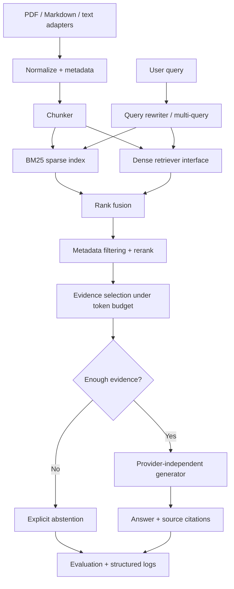

# Hybrid RAG Intelligence Engine

A modular Retrieval-Augmented Generation (RAG) reference focused on evidence quality, citation contracts, and measurable retrieval. Rather than binding every layer to one vendor, it defines provider-neutral protocols and includes deterministic offline components for study.

## Problem statement

A generative model may confidently answer from incomplete or irrelevant context. RAG adds a retrieval stage, but retrieval alone does not guarantee that the final answer is supported. This project makes the evidence path explicit: ingestion → normalized chunks → sparse and dense retrieval → fusion → reranking → budgeted context → generation or abstention → separate evaluation.

### Goals and non-goals

**Goals:** inspectable BM25 and feature-hashing retrieval; pluggable real dense embeddings, rerankers and generators; metadata filtering; query rewriting; citation tracking; an evidence insufficiency path; retrieval and answer metrics; deterministic no-key demo.

**Non-goals:** a production vector database, guaranteed factual answers, a hidden chain-of-thought interface, a specific cloud vendor, or claims that lexical mock generation equals a capable language model. The deterministic dense retriever is based on hashed token features, not a learned embedding model.

## Architecture



## Repository layout

```text
hybrid-rag-intelligence-engine/
├── README.md / pyproject.toml / LICENSE / REFERENCES.md
├── configs/demo.json
├── docs/{architecture.md,implementation-guide.md,design-decisions.md}
├── examples/synthetic_documents.json
├── scripts/demo.py
├── src/rag_engine/
│   ├── config.py / schema.py / pipeline.py
│   ├── ingestion/{loaders.py,chunking.py}
│   ├── retrieval/{base.py,bm25.py,dense.py,hybrid.py}
│   ├── query.py / reranking.py / context.py / generation.py
│   └── evaluation/metrics.py
└── tests/
```

## Installation instructions for a future environment

Python 3.10+. NumPy is required; `pypdf` is optional and only needed for PDF extraction; pytest is optional for the supplied test sources.

```bash
python -m pip install -e ".[dev,pdf]"
python scripts/demo.py
```

These commands were not executed while building the archive. The demo is designed to use synthetic documents, a deterministic hash-based dense retriever, BM25, rank fusion, a lexical reranker, and a mock generator. No API keys are required to study the architecture.

## Data preparation

`ingestion/loaders.py` supplies text and Markdown loaders plus a lazily imported PDF adapter. A loaded `Document` has an ID, text, and metadata. The chunker retains parent identifiers and source offsets. For real corpora, preserve access-control metadata, legal/provenance fields, document revision dates, and source identifiers. Avoid indexing secrets or documents the querying user cannot access.

## Configuration and usage

`configs/demo.json` configures chunk length/overlap, top-k values, reciprocal-rank fusion, context token budget, and abstention threshold. The demo builds a tiny synthetic corpus in memory and prints retrieved source IDs alongside the generated response. The same core interfaces can be wired to a learned embedder or remote generator through adapter classes without changing the pipeline contract.

## Retrieval quality vs. answer quality

Retrieval quality asks whether relevant evidence appears near the top of a candidate list; useful diagnostics include Recall@k, MRR and nDCG. Answer quality asks whether the response is correct, supported by the selected evidence, and attributed to the right source. Good generation cannot recover evidence the retriever never returns, and excellent retrieval can still be followed by unsupported generation. Evaluate these stages separately and then measure end-to-end task outcomes.

Naive RAG failure modes include arbitrary fixed-size chunks that split definitions, mismatched query/document normalization, semantically weak dense vectors, BM25 term mismatch, naive score addition across incomparable scales, context-window crowding, duplicate evidence, stale sources, lost metadata, citation IDs that do not point to cited claims, and generators that answer despite missing evidence. Explicit abstention reduces one failure class but needs calibration against false abstentions and unsupported answers.

## Engineering choices and trade-offs

- **BM25 implementation:** transparent lexical baseline; no stemming or domain-specific analyzer by default.
- **Hash-based dense retrieval:** reproducible and offline; not semantically equivalent to learned embeddings.
- **Reciprocal-rank fusion:** avoids assuming sparse and dense scores share a scale; sacrifices some score calibration information.
- **Token-budget estimator:** approximate word-based estimate; replace with the target generator's tokenizer for strict limits.
- **Mock generator:** demonstrates citations and abstention; it does not synthesize rich language or prove factuality.

## Hardware, limits and future work

The demo is CPU-friendly. Index memory scales with chunk count and vector dimension; retrieval latency scales with query count, candidate count and corpus size in these simple in-memory implementations. Future extensions include persistent indexes, ACL-aware retrieval, a learned embedding adapter, cross-encoder reranking, tokenizer-aware budgeting, query-set versioning, asynchronous provider calls, and human-reviewed faithfulness evaluation.

No retrieval benchmark, generation test, application, or automated test has been run for this archive. All example documents are synthetic and no answer-quality score is claimed. See `REFERENCES.md` for research context.
